# Agentic RAG Platform — Design (Phases 0–7)

The platform answers questions from a document collection with **cited answers**, says
**"I don't know"** when the documents don't contain the answer, and **measures its own quality**.

| Phase | What it adds | Status |
|---|---|---|
| 0 | Sample corpus: 6 documents of a fictional AI team, "Lumora Labs" | ✅ |
| 1 | RAG core: index documents, retrieve passages, write cited answers | ✅ |
| 2 | Evaluation: golden questions, retrieval + abstention metrics, RAGAS | ✅ (full run pending quota) |
| 3 | Agentic mode: an LLM workflow that plans, grades, rewrites and verifies | ✅ (comparison run pending quota) |
| 4 | Optimizer: agents run retrieval experiments and propose better settings | ✅ |
| 5 | REST API: ask, upload/list/delete documents, config, eval runs; admin keys + guest chat | ✅ |
| 6 | Web UI (Angular): chatbot with memory, admin pages (documents, evaluation, usage, settings) | ✅ |
| 7 | Observability (LangSmith + usage log), Docker Compose, CI with a quality gate | ✅ |

---

## 1. The system at a glance

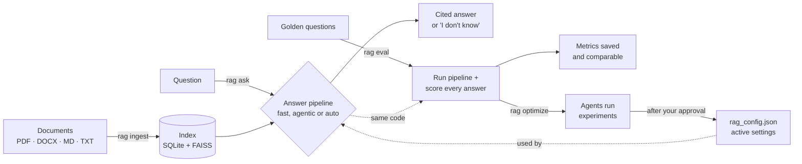

Four jobs:
1. **Index** documents once, and again only for what changed.
2. **Answer** questions from the indexed passages, in one of three modes: fast, agentic or auto
   (fast first, agentic only when needed).
3. **Evaluate** the answering pipeline on a fixed set of questions with known answers.
4. **Optimize** the settings: agents test configurations and propose the best one to you.

All settings (chunk size, top-k, retrieval type, threshold, mode) live in **`rag_config.json`**,
versioned in git like `appsettings.json`. Command-line options override it for one run.

---

## 2. Indexing — `rag ingest`

Documents are split into small passages (**chunks**). Each chunk is turned into a vector
(**embedding**) that captures its meaning, so similar text can be found by vector similarity.

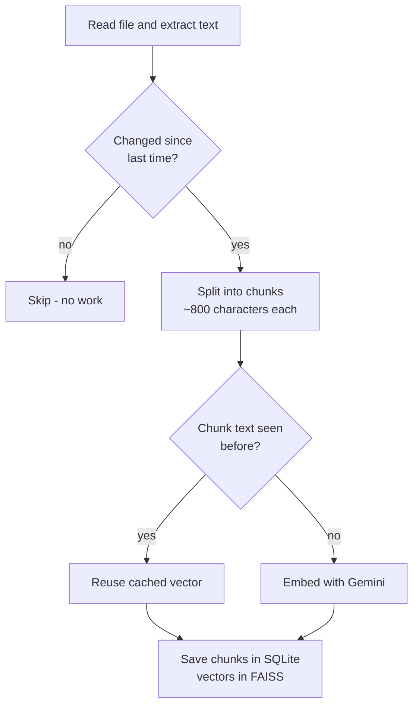

- **SQLite** is the source of truth: document text, chunks with their exact character
  positions, cached vectors, and evaluation runs.
- **FAISS** is the fast vector search index. It can always be rebuilt from SQLite, with no API calls.
- Re-running `rag ingest` costs nothing for unchanged documents. A deleted file is removed from
  the index.

### Collections - one search index per collection (2026-10-24, plan section I phase 1)

Documents belong to a **collection** ("AI Engineering Handbook", "HR policies"); a chat searches
exactly one collection, so unrelated domains never mix.

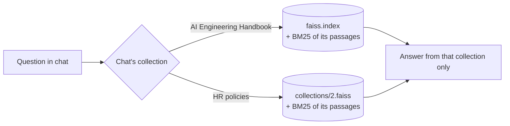

- **Data:** table `collections` (name, description, `owner` - empty = shared; phase 2 adds
  private ones); `documents.collection_id` and `conversations.collection_id` (added by a
  migration; rows from before collections belong to collection 1).
- **Isolation by construction:** each collection has its **own FAISS file**
  (`Settings.collection_index_path`: collection 1 keeps `data/index/faiss.index`, others
  `data/index/collections/<id>.faiss`) and its own BM25 index built only from its passages
  (`BM25Index.from_store(store, collection_id)`). Every store read used for search
  (`chunk_ids`, `chunk_vectors`, `chunk_texts`, `chunks_version`) takes the collection
  (`_in_collection`), and `open_index` rebuilds a collection's file from SQLite if it drifts. A
  question in one collection cannot reach another collection's passage - there is no shared
  index to filter (a filter bug would leak; separate files can't).
- **Collection 1 = the demo collection:** the golden set belongs to it, so evaluation, the
  quality check, the optimizer and the CI gate work on it, unchanged; it can be renamed but not
  deleted. Optimizer re-indexing touches only it (one chunking setting for all collections until
  phase 4).
- **Chats:** a new conversation takes the collection picked on the welcome screen
  (`collection_id` in `POST /chat`); follow-ups always search the conversation's own collection.
- **Similarity threshold per collection** (`retrieval/calibration.py`): scores depend on the
  documents (a short resume scored 0.64-0.675 for real questions, under the global 0.68), so each
  collection gets its own value, set by the system: after every upload/delete, 12 clearly
  unrelated probe questions ("What is the capital of France?") are scored against the collection
  and the threshold goes just above the best of them (+0.01; probe vectors cached, no chat
  calls). Measured on real data: AI handbook 0.61, HR 0.58, Resume 0.58 - every real question
  above. Precedence: demo collection = its measured value from `rag_config.json` (0.68, stricter
  because its test set has near-topic questions) > admin override (collection dialog) >
  automatic > global value. Limit: a near-topic question the documents don't answer passes the
  probe threshold; the model then abstains (one chat call). Phase 4 adds measured values from
  test sets for every collection.
- **"Found in another collection"** (chat): after a threshold refusal the server checks the other
  collections with the same question (one embedding, no chat call) against their own thresholds
  and the answer lists them (`found_in`); the UI offers "Ask in <collection>" (a new chat there).
  The sidebar shows each chat's collection once chats come from 2+ collections; a new chat shows
  "Searching in <collection>" above the question box.
- **Private collections (phase 2, 2026-10-24):** any signed-in user can create collections of
  their own (`owner` = the user's owner hash), upload into them and ask questions; nobody else
  sees them. One rule in `api/deps.py` decides every access: `can_see` (shared, or the caller
  owns it) and `can_manage` (shared: admins; private: only the owner - **not admins**).
  Someone else's private collection answers **404** everywhere (list, chat, `/assistant`,
  documents, upload, rename, delete) so its existence isn't revealed; the "Ask in" hint only
  checks collections the caller may see. Admins see totals only
  (`GET /collections/private-summary`), never names, documents or answers: Live quality
  (`usage_rows`) and the admin document list leave private collections out. Per-user limits
  (`USER_MAX_COLLECTIONS` 5, `USER_MAX_DOCUMENTS` 20, `USER_MAX_PASSAGES` 500) are checked
  before any embedding call (chunking is free). Collection names are unique per owner (one-time
  table rebuild for older databases). `DELETE /me` deletes the user's private collections
  (rows, index files, uploads), chats, sessions and account. Guests can't create collections.
- **Uploads:** `data/uploads/` for collection 1 (as before), `data/uploads/<id>/` for others, so
  the same file name can exist in two collections. Deleting a collection removes its documents,
  passages, chats, index file and uploaded files in one step.

---

## 3. Answering — fast mode (`rag ask`)

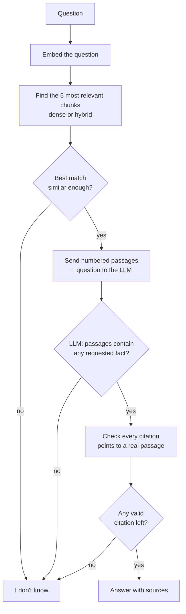

**Grounding**: the LLM may only use the labelled passages and must cite them, e.g. `[P2]`. Code
then removes citations that point nowhere and stores the valid ones as `[2]`. (The `P` keeps
passage labels apart from numbers in the text: with plain `[1]` a model once cited `[3]` because
the passage started with the heading "3. Parental leave"; small models still did it, so the prompt
also ends with "Cite only these passage labels: [P1] to [P5]".) **Abstention** at three checkpoints keeps the system
from inventing answers. **Partial answers** are allowed: for a broad question ("what are all the
metrics?") the model answers what the passages support and says what they don't cover; it
abstains only when the passages contain none of the requested facts. (Before this rule, such
questions were refused because the model couldn't prove its list was complete. A live check
afterwards: broad questions answered, all 10 unanswerable golden questions still refused.)
**Overview questions** ("what is X", or just a topic name like "LLM evaluation") get a cited
summary of what the passages say about X, even without a one-line definition. Questions far
from the documents ("what is LangGraph?") are stopped earlier by the similarity threshold
(0.68 since the optimizer's recommendation was applied), with no LLM call.

Cost: **1 LLM call** per question.

**Slow provider:** each model request times out after 20 s and is retried at most twice
(`CHAT_TIMEOUT_SECONDS`, `CHAT_MAX_RETRIES`; library defaults were no timeout and 6 retries,
which hung questions for 1-2 minutes during a Gemini overload). The user then sees "The AI
service is slow or overloaded right now" instead of an endless spinner.

**In-memory indexes (API):** the API keeps the FAISS index and the BM25 keyword index in memory
(`SearchCache` in `api/service.py`). Before each question a cheap stamp - number of passages,
highest passage id (never reused) and the FAISS file's time - is compared; only an upload,
delete or `rag ingest` changes it and triggers one rebuild. Previously both were rebuilt on
every request (4.6 ms at 80 passages, growing with the collection). The CLI and evaluations
build their own indexes as before.

### Dense vs hybrid retrieval (`retrieval` setting)

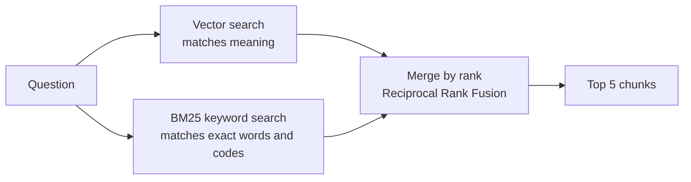

**Dense** search finds text with similar *meaning* but can miss exact tokens such as error
codes (`LUM-2001`), names or a single table row. **Hybrid** search adds BM25 keyword matching and
merges both rankings by position, which works even though the two scores are on different
scales. Every chunk keeps its similarity score, so the "similar enough?" check works in both modes.

---

## 4. Answering — agentic mode (`rag ask --mode agentic`)

Agentic mode adds LLM decisions where fast mode is weak: questions that need several facts,
wording that doesn't match the documents, and answers that drift from the passages.

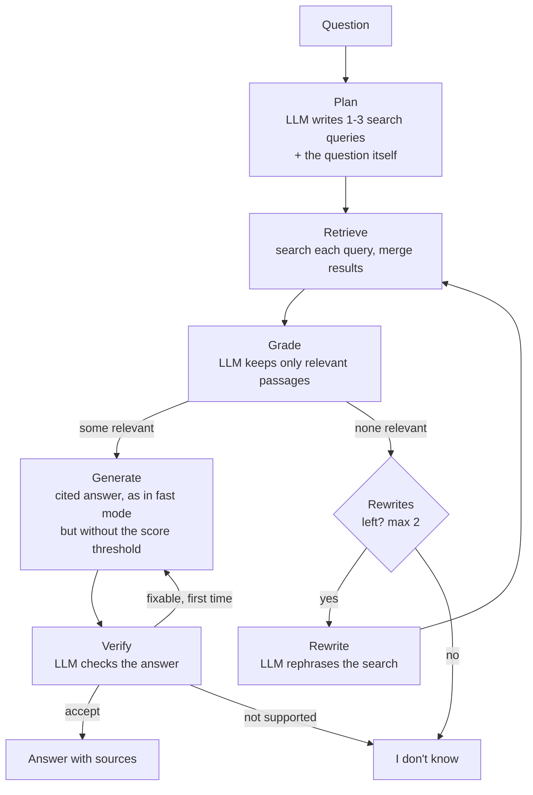

| Step | Why it helps |
|---|---|
| Plan | A two-part question gets one search per part; the original question is searched too (planned keyword queries sometimes match worse) |
| Grade | Irrelevant passages are removed before the answer is written. Generate then skips the similarity threshold: the grader already confirmed relevance (a table of names scored 0.60 while holding the answer) |
| Rewrite | A second chance when the question's wording doesn't match the documents |
| Verify | Catches unsupported claims; one retry with feedback. Generate also retries once (same budget) when every citation was invalid |

Loop limits (max 2 rewrites, max 1 regeneration) are enforced in code, so the agent always stops.
Built with **LangGraph**: each box is a function, and the arrows are routing rules.
`--trace` prints the path a question took.

Cost: about **4 LLM calls** per question, roughly 2× the latency of fast mode.

### Fast vs agentic

| | Fast | Agentic |
|---|---|---|
| LLM calls per question | 1 | ~4 |
| Passages given to the answer | top 5, as retrieved | only the relevant ones |
| Multi-part questions | single search | planned searches |
| Self-check | citation check | citation check + verifier |

All modes are exposed the same way (`question → answer`), so the CLI, evaluation and the API
don't care which one runs.

### Auto mode - fast first, agentic when needed (2026-10-22)

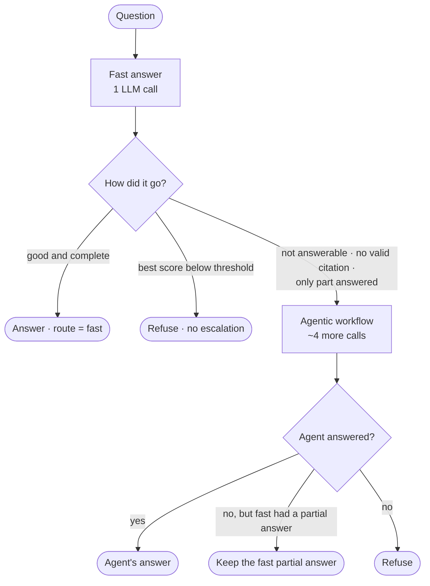

The fast answer's structured output has a field `complete` ("is every part of the question
answered?"), filled in the same call - so detecting a partly answered (often multi-part) question
costs nothing extra. A **threshold refusal is not escalated** (owner decision): the measured best
scores of off-topic and unanswerable questions (0.61-0.81) overlap with valid questions worded
differently, and agentic mode would spend ~6 calls before refusing an off-topic question; a
threshold that refuses valid questions is fixed by calibration (quality check: safe threshold).
Every answer records its `route` ("fast" or "auto → agentic (reason)"); Live quality shows how
many questions were escalated. Admins switch the mode directly in Admin › Settings
(`PUT /config/mode`); optimizer recommendations ignore the mode (they measure search only) and
applying one keeps the current mode.

### Answer model - Gemini and Groq with automatic fallback (2026-10-24, plan G2/G3/G5)

The chat model the whole app uses is `llm.FallbackChat`: Gemini, plus Groq when `GROQ_API_KEY`
is set. Admin › Settings › **Answer model** picks which one writes answers first and whether the
other takes over (`PUT /config/model`; stored in `rag_config.json` as `chat_provider` /
`chat_fallback`, read on every call, so no restart).

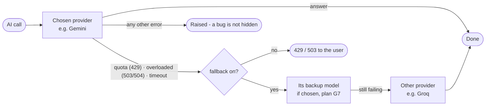

- `FallbackChat` offers what the app calls on a model (`invoke`, `with_structured_output`,
  `bind_tools`), so answering, analyse mode, the agent and the optimizer need no change.
- **Only chat moves.** Embeddings stay on Gemini (vectors of different models can't be compared)
  and so does the RAGAS judge (comparable scores).
- Groq uses **JSON-schema structured output**: with tool calls `gpt-oss-120b` answered correctly
  but dropped the `[P1]` markers. Checked on 10 golden questions from the CI snapshot index (no
  Gemini calls): 9/10 (the miss refused instead of answering uncited); all 9 structured-output
  schemas of the app accepted.
- Limits: Groq free tier ~1,000 requests/day but ~8,000 tokens/min per model (an answer prompt is
  ~2,000 tokens) - `GROQ_REQUESTS_PER_MINUTE` 5. `GET /config/providers` shows which providers
  have a key (never the key); the usage log names the model of every call.

### Model choice - answer, backup and judge models in Settings (2026-10-25, plan G7)

Admin › Settings › **Models** (`api/models.py`, UI `features/settings/models-card.ts`) chooses the
models without editing `.env` or restarting. Stored in `rag_config.json` (`gemini_model`,
`groq_model`, `judge_model`, `gemini_backup_model`, `groq_backup_model`; "" = the `.env`
default / no backup); they are admin choices like the mode, so optimizer recommendations keep
them.

- **Model lists:** `llm.list_chat_models` reads the providers' lists (free, no quota), keeps only
  text-chat models (Gemini: `gemini-<version>-flash|pro[-lite][-preview]`; Groq: no speech /
  guard models, context ≥ 32k) and caches them 10 minutes; if a list fails, only the current
  models are shown.
- **Backup model** of the same provider: quota and overload are **per model**, so another
  Gemini model often still works when the first one doesn't. With fallback on, `FallbackChat`
  tries: chosen provider's model → its backup → the other provider's model → its backup
  (`FallbackChat.attempts`); fallback off = exactly one model, so the UI locks the backup
  dropdowns while it is off. The fallback switch stays usable with one provider (a Gemini backup
  needs no Groq key). Models by name are built once
  (`FallbackChat.named`, own rate limiter per model).
- **Test** (`POST /config/models/test`): one tiny call to exactly that model, no fallback.
- **Quality check** (`POST /config/models/check`, background, page polls `GET /config/models`):
  6 golden questions (q06, q11, q16, q26, q36 + the unanswerable u01) in fast mode on the demo
  collection with exactly that model; pass = cites an evidence document / refuses u01; at least
  5 of 6. A new answer or backup model can't be saved without a passing check (409) - a model can
  answer "hello" and still break the contract (Groq once dropped the citations). Results in
  `data/index/model_checks.json`. Cost: up to 6 answer calls.
- **Judge:** Gemini only, no check, but switching asks first: scores of different judges are
  not comparable, so every score records its judge (`answer_scores.judge`, shown in the
  playground). `Services.answer_evaluator()` rebuilds the RAGAS evaluator when the judge changes.
- **Embedding model:** shown locked. A change means re-embedding every document (vectors of two
  models can't be compared) and re-exporting the CI snapshot - a deliberate `.env` change.

### Analyse mode - every document of a collection (2026-10-24, plan C14 / phase 3)

Fast and agentic mode read the top 5 passages - often from one or two documents. A question like
"compare the 2025 and 2026 policies" or "what is the overall picture?" needs every document, so
the chat has a per-question toggle **"Analyse all documents"** (signed-in users and admins).
`generation/analyse.py` uses **map-reduce**, the standard pattern for multi-document questions:

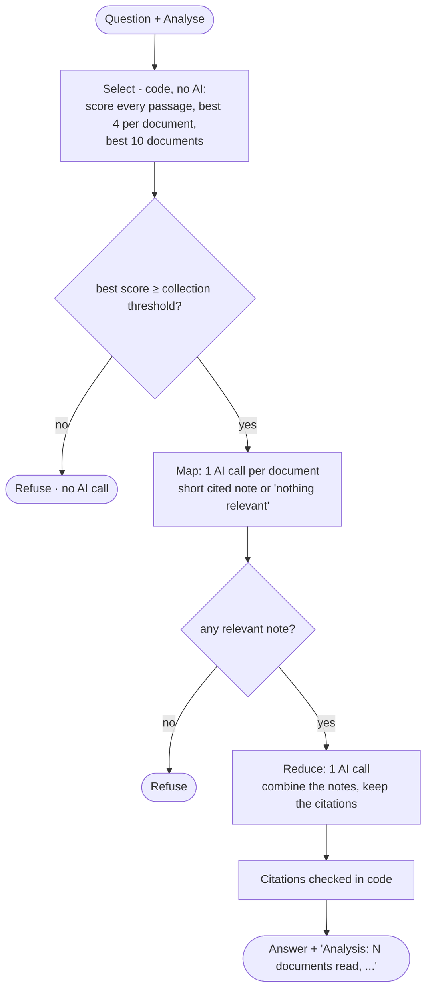

- Passages get **global** labels across all documents ([P1]..[Pn]), so the combined answer's
  citations map straight to sources, exactly as in fast mode.
- **Nothing dropped silently:** the answer's `route` says how many documents were read, had
  nothing on the question, were over the limit of 10 or failed (a provider error on one document
  skips that document; only if every document fails is it a 503). The chat shows it under the
  answer ("Analysis: 5 documents read, 2 without anything on this").
- Cost: up to 11 chat calls, so one analysis counts as **5 questions** toward the hourly limit
  (`chat.ANALYSE_COST`; `RateLimiter.hit(..., cost)`); guests get 403. Follow-ups are rewritten
  first, as in every chat turn; a conversation keeps its collection.
- Plain Python, not LangGraph: a fixed sequence with no decisions for an agent to make.

---

## 5. Evaluation — `rag eval run`

### The golden set
50 questions with known answers: 40 answerable (2 need two documents) and 10 deliberately
**unanswerable**. Each answerable question records the **exact text in the document** that
answers it (its *evidence*).

### How a retrieved chunk is judged relevant

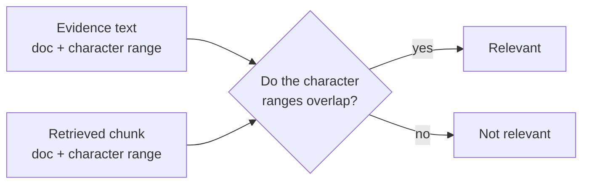

Labels point at **text positions, not chunk ids**, so the same golden set still works when chunk
size changes. The Phase 4 optimizer depends on that.

### What happens per question

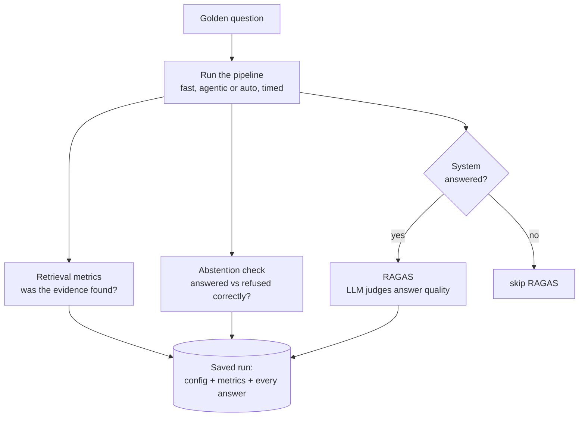

### Metrics

| Group | Metric | Question it answers |
|---|---|---|
| Retrieval | **Recall@K** | Did the evidence reach the LLM? |
| | **MRR** | Was the right passage near the top? |
| | Precision@K | How much noise was in the passages? |
| | Hit rate@K | Was anything relevant found? |
| Abstention | Abstention accuracy | Answered when it should, refused when it should? |
| | False abstention rate | How often did it refuse an answerable question? |
| | Unanswerable-answered rate | How often did it make up an answer? |
| Answer quality (RAGAS) | Faithfulness | Is every claim supported by the passages? |
| | Answer relevancy | Does it answer the question asked? |
| | Context precision / recall | Were the right passages used and ranked well? |
| | Answer correctness | Does it match the expert's reference answer? |
| Operations | Latency avg / p95 | How long do answers take? |

Retrieval and abstention metrics are plain code: exact and free. RAGAS uses an LLM judge,
about 12 calls per answered question.

### Comparing runs
Every run stores the exact settings it used. `rag eval compare A B` shows the settings that
differ, the change in each metric, and which questions changed outcome. A run interrupted by an
API limit is saved, and `--resume` finishes it later.

`rag eval run --retrieval-only` skips the LLM entirely: it measures retrieval and a
similarity-only "I don't know" gate. It is exact, makes no chat calls (question vectors are
cached), and is what the optimizer uses for its experiments. The admin UI runs the same thing as
a **quality check** (`POST /eval/runs`, about a second), on the default or an uploaded test set.

### Release gates
`data/eval/release_gates.json` holds the playbook's thresholds (Recall@5 ≥ 0.85, MRR ≥ 0.70,
abstention accuracy ≥ 0.90, faithfulness ≥ 0.90, answer correctness ≥ 0.80; answer relevance
and P95 latency are warnings). `evaluation/gates.py` checks a run against them: pass / fail /
warn, or **n/a** when the run didn't measure the metric (a retrieval-only run has no answers,
so it is judged on Recall@5 and MRR only). The UI shows the result per run; the CI gate
(Phase 7) will reuse the same file.

### Online evaluation — quality from real chats (no test data)
The golden set needs an answer key. Two RAGAS metrics don't: **faithfulness** (is every claim
supported by the retrieved passages?) and **answer relevancy** (does the answer address the
question?). They are measured on real usage, automatically:

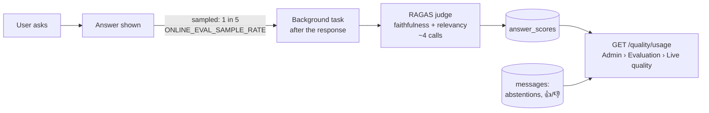

- The user never waits: the response is sent before the background task starts. Errors (e.g.
  quota) are stored with the score row, never raised.
- **Suggestions** (plain code, free): questions the documents couldn't answer (grouped, with a
  count — a frequent one means a missing document), answers users disliked, answers scored
  below 0.7, and per-document numbers (answers citing it, average scores, 👎).
- Cost on the free tier: the judge shares the chat model's rate limit, so a user's next question
  can wait a few seconds right after a scored answer. `JUDGE_MODEL` (another model name) gives
  the judge its own limiter and daily quota.
- Live check: 2 real answers scored (faithfulness 1.0 / 1.0, relevance 0.95 / 1.0), 4 judge
  calls each.
- **Per answer:** `GET /quality/usage` also returns every answer (newest first) with its scores,
  status, documents and feedback; the UI filters and searches it. In development builds the chat
  shows a scored answer's numbers under it (production users never see them).
- **Team testing is kept apart:** answers asked while signed in as admin are marked `by_admin`
  and left out of the numbers unless `?include_admin=true` ("Include admin chats" switch).
- **Test a question** (`POST /quality/test`, admin; optional `collection_id`, default the demo
  collection, chosen with "Search in" chips above the box - like a new chat it searches only that
  collection, with its threshold and its example questions): runs the live pipeline on one question and
  scores the answer on the spot (always, not sampled). Nothing is saved. ~5 calls (0 if the
  similarity threshold refuses it first).

---

## 6. Optimization — `rag optimize`

A team of agents improves the retrieval settings. You approve the result.

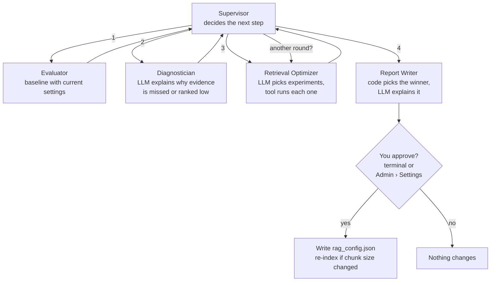

**One experiment** = evaluate one configuration on the golden questions, retrieval only
(no chat calls). Settings the optimizer may try: `retrieval` (dense/hybrid), `top_k`,
`chunk_size`/`chunk_overlap`. A new chunk size gets its own experiment index. Vectors are
shared between indexes, so applying a winner later re-indexes without new embedding calls.

| Who decides | What |
|---|---|
| **Code** | Order of steps with no real alternative · budgets (experiments per round, rounds) · argument validation · **which experiment wins** (Recall@K, then MRR, then unanswerables blocked) · the safe "I don't know" threshold |
| **LLM** | Diagnosis · which experiments to run (tool calling) · whether another round is worth it · the written explanation |
| **You** | Whether the change is applied |

The "safe threshold" is the highest similarity cut-off that would not have refused any
answerable question. It blocks some unanswerable questions before any LLM call.

A live run taught one lesson. The LLM supervisor wanted to stop at Recall 0.99 while MRR
was 0.85, so "is there anything to improve?" is now decided in code: are any questions failing?

**Approval in the UI:** the report is saved in SQLite (`recommendations`, status pending →
applied / rejected / superseded). `rag optimize --decision later` stops there, and an admin
applies or rejects it on the Settings page. Apply refuses if `rag_config.json` changed since the
report was made ("stale"), because its numbers were measured against the old settings.

**Start from the UI:** Admin › Settings › *Find better settings* starts the same optimizer with the
default test set or the admin's own `.jsonl` test set (`POST /optimizer/runs`). It takes minutes,
so it runs as a FastAPI background task; the page polls `GET /optimizer/run` every 3 s and shows
the progress lines. The outcome is a saved recommendation ("measured on <test set>"), "current
settings already best", or "nothing to improve". One quality job at a time: a quality check and
an optimizer run share a lock (409). The progress lives in memory (the API runs as one process);
the recommendation itself is in SQLite. A test set for your own documents is how settings get
tuned per document collection (e.g. the HR test set measured a safe threshold of 0.59 vs 0.68).

Cost per optimization: about 10–15 chat calls for the agents. Experiments cost only embeddings
for new chunk sizes, throttled to the free-tier limit.

---

## 7. REST API — `rag serve`

**FastAPI** defines the endpoints (like ASP.NET Core minimal APIs). **Uvicorn** is the web
server that hosts them (like Kestrel). Interactive docs are at `/docs`.

Callers (no registration form; checked in this order by `deps.current_caller`):

| Caller | Sends | Can use |
|---|---|---|
| **Signed-in user** (Sign in with Google, plan B1) | `Authorization: Bearer <session token>` from `POST /auth/google` | Chat endpoints and `GET /me`; chats on every device; `USER_QUESTIONS_PER_HOUR` (50) per user. **Admin** (everything) when the email is in `ADMIN_EMAILS` |
| **Admin by key** | `X-API-Key`: one of `API_KEYS` in `.env` | Everything (scripts, CLI tools, the UI fallback when Google sign-in is off) |
| **Guest** (end user) | `X-Guest-Id`: a random id the browser generated once | Chat endpoints and `GET /me`; at most `GUEST_QUESTIONS_PER_HOUR` (20) questions per IP |

**Sign in with Google (OpenID Connect, `api/auth.py`):** the browser gets an ID token from
Google's button (the user signs in on Google's page); `POST /auth/google` verifies it with
google-auth (Google's signature, audience = `GOOGLE_CLIENT_ID`, issuer, expiry, verified
email), creates/updates the `users` row and starts **our own session**: a random 256-bit token,
stored only as its SHA-256 in `sessions`, valid `SESSION_DAYS` (7); `POST /auth/logout` deletes
it (revoked at once). Google's 1-hour ID token is not reused per request. Admin = email in
`ADMIN_EMAILS`, decided per request. Guest conversations are **not** moved into the account
(an earlier version did; on a shared computer someone else's guest chats would land in your
account): they stay with the browser's guest id and reappear after signing out. A signed-in
non-admin gets 403 on admin
endpoints. Expired sessions are removed by the daily retention job. Tests fake the Google check.

| Endpoint | Who | Purpose |
|---|---|---|
| `GET /health` | anyone | Liveness check |
| `GET /ready` | anyone | Readiness: rag_config.json loads, SQLite answers, FAISS index loads (no model call); 503 + the failed check. Used by the Docker healthcheck; the UI container starts only when the API is healthy |
| `GET /me` | guest, user, admin | The caller's role (`admin`/`user`/`guest`; the UI shows Admin pages only for `admin`) and, when signed in, name, email and picture |
| `GET /auth/config` | anyone | The Google client id for the sign-in button (empty = Google sign-in off) |
| `POST /auth/google` · `POST /auth/logout` | anyone · user | Sign in with a Google ID token → session token; sign out (ends the session) |
| `GET /assistant[?collection_id=]` | anyone | What a collection covers, from `assistant.json` + its documents: description, topics, example questions |
| `GET /collections` | anyone | Shared collections + the caller's own private ones, with counts, threshold, `is_private`, `can_manage` |
| `POST /collections` · `PUT /collections/{id}` · `DELETE /collections/{id}` | admin (shared) · signed-in user (own private) | Create (users: always private; admins: shared, or private with `private: true`; per-user limit) · rename · delete with documents, chats, index and files (demo collection: 409) |
| `GET /collections/private-summary` | admin | Totals over all private collections (collections, users, documents, passages) - never content |
| `DELETE /me` | signed-in user | Delete my account: private collections, chats, sessions, user |
| `POST /chat` · `GET/DELETE /conversations` · `GET/DELETE /conversations/{id}` · `PUT /messages/{id}/feedback` | guest, admin | Conversations with memory, history and feedback (section 8) |
| `POST /ask` | admin | One independent question; optional `mode`, `retrieval`, `top_k` override `rag_config.json`; `collection_id` (default: the demo collection) |
| `GET /documents[?collection_id=]` · `POST /documents` (form field `collection_id`) · `DELETE /documents/{id}` | whoever may manage the collection | List, upload (and index), remove - admins: shared collections; users: their private ones (within limits) |
| `GET /config` · `PUT /config/mode` | admin | The active settings · switch the answer mode (fast / agentic / auto) |
| `GET /eval/runs` · `GET /eval/runs/{id}` | admin | Runs with type, release-gate status, "uses the active config"; one run with gate checks |
| `POST /eval/runs` | admin | Quality check of the active config (retrieval only, no chat calls); optional uploaded test set (`.jsonl`, validated first) |
| `PUT /eval/runs/{id}/hidden` · `GET /eval/gates` | admin | Hide old test runs · the gate thresholds |
| `GET /optimizer/recommendation` · `POST …/{id}/apply` · `POST …/{id}/reject` | admin | The optimizer's latest recommendation and the human decision |
| `POST /optimizer/runs` · `GET /optimizer/run` | admin | Start the optimizer in the background (optional own test set) · its progress and outcome |
| `GET /quality/usage[?include_admin=true]` | admin | Live quality from real chats: totals, sampled faithfulness/relevance, every answer with its scores, suggestions, per document |
| `POST /quality/test` | admin | Answer one test question (in a chosen collection) and score it now; not saved |

### What happens to an upload

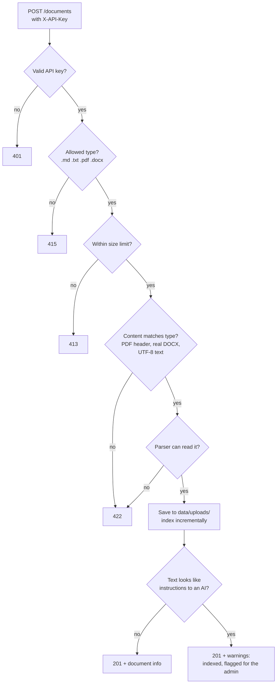

- **Admin keys** come from `API_KEYS` in `.env` and are compared in constant time. With no
  keys configured the admin endpoints refuse requests instead of running open.
- **Guests** can only chat, about their own conversations. They can't override the answer mode
  or search method (403), and the hourly limit per IP protects the model quota (429 +
  `Retry-After`). `GUEST_QUESTIONS_PER_HOUR=0` turns guest access off.
- **File names** are reduced to a safe base name, so `../../etc/passwd.md` becomes `passwd.md`.
- **Prompt-injection scan (plan B6, layer 2):** `uploads.suspicious_lines` matches order-like
  phrases aimed at an AI ("ignore all previous instructions", "you are now a...", "reveal your
  system prompt", "do not tell the user", "new instructions:", chat-template tokens such as
  `<|im_start|>`). It only **warns**: the document is indexed, `DocumentInfo.warnings` lists up to
  3 lines (upload response and `GET /documents`, scanned from the stored text on every listing,
  so CLI-ingested documents count too) and the API log notes it (without the text). Admin ›
  Documents shows a "Check content" badge. Warn, not block: real documents may quote such
  phrases; the patterns need an order-like shape, so text *about* prompt injection (the sample
  runbook) is not flagged. Layer 1 stays the prompt rule `UNTRUSTED_PASSAGES`.
- **Concurrency:** questions run in parallel. Uploads and deletes take one lock, so SQLite and
  the vector index are never written at the same time. The index file is replaced
  atomically, so a reader never sees half a file.
- **Errors** are clear status codes: quota or provider problems give 503, never a crash.
- **Same building blocks as the CLI:** `build_answerer`, `ingest`, `rag_config.json`. Tests
  swap Gemini for fakes through FastAPI's dependency injection (`dependency_overrides`).
- Long jobs (`eval run`, `optimize`) stay in the CLI for now.

---

## 8. Chatbot with conversation memory — `POST /chat`

A real chatbot must understand follow-ups. "and who holds that role?" contains none of the
words that identify the topic, so searching with it finds nothing. Before searching, the
follow-up is rewritten into a standalone question using the last few turns ("question
condensing"):

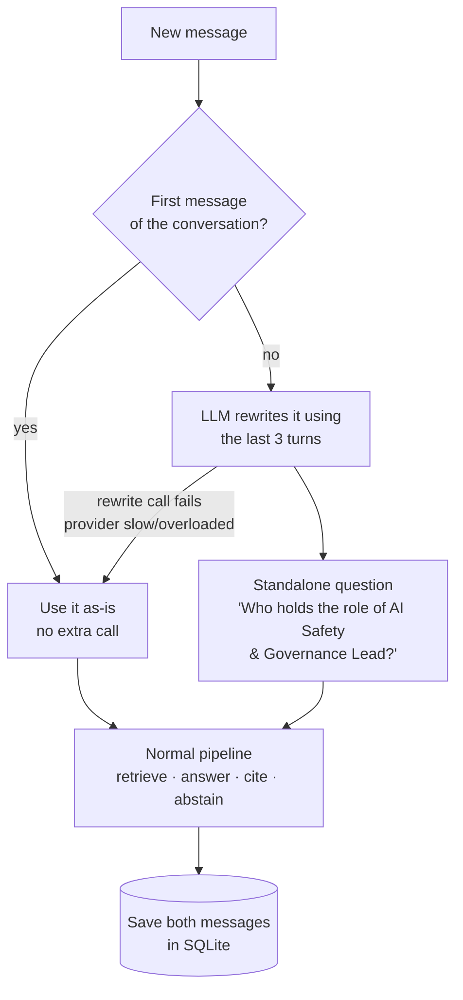

- **Unchanged pipeline:** the rest of the RAG pipeline doesn't know about conversations. It
  answers the standalone question, so memory works for fast and agentic mode alike.
- **Cost:** one extra LLM call, and only for follow-ups.
- **Graceful degradation:** the rewrite is optional. If its call fails (provider slow,
  overloaded or out of quota), the message is answered as typed: a complete question still gets
  its answer; a real follow-up may be refused as "not covered", never guessed. Only if the answer
  call fails too does the user see the 429/503 message.
- **Stored in SQLite:** conversations and messages, with each answer's sources, the standalone
  question and the user's 👍/👎 feedback (kept for later evaluation and monitoring).
- **Privacy:** each conversation belongs to the guest id (or, for API clients without one, the
  admin key) that created it, stored as a hash. Anyone else gets "not found", exactly as if the
  conversation did not exist. The UI always sends its guest id, so signing in as admin keeps the
  browser's own history.
- **Data retention (plan B10):** `api/retention.py` runs at startup and daily (an asyncio task
  started by the FastAPI lifespan; the SQLite work in a worker thread): conversations whose last
  activity is older than `CHAT_RETENTION_DAYS` (90) are deleted with their messages, feedback
  and online scores (ON DELETE CASCADE), usage-log rows older than `USAGE_RETENTION_DAYS` (90)
  too; 0 keeps them. Eval runs, recommendations and documents are not personal data and stay.
  `DELETE /conversations` deletes all of the caller's conversations (sidebar "Delete all", with
  confirmation). `GET /assistant` returns `chat_retention_days`, shown under the chat input.
- **Endpoints:** `POST /chat`, `GET/DELETE /conversations`, `GET/DELETE /conversations/{id}`,
  `PUT /messages/{id}/feedback`. `POST /ask` remains for single questions and evaluation.
- **No streaming by design:** answers are validated (citations checked, abstention) before they
  are shown, which needs the complete answer. The UI shows a typing indicator instead.

---

## 9. Web UI — `ui/` (Angular)

A separate Angular app in the same repository, laid out like common chat products. It talks to
the backend **only through the REST API** (like an Angular ClientApp next to an ASP.NET Core
Web API).

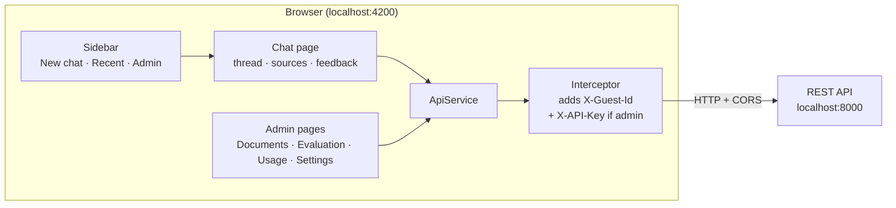

| Area | What the user sees |
|---|---|
| **Chat** (`/chat`, `/chat?c=5`) | Message thread with the input at the bottom, typing indicator, cited answers with an "N sources" popup (click a number to read the passage), copy, 👍/👎, and a friendly "I couldn't find this in the documents" that suggests the covered topics. Every message shows its time and every answer how long it took ("answered in 6.2 s"); while waiting, a counter ("Thinking… 12 s") and, after 20 s, a "the AI service is slow" hint. Citation markers like [2] are clickable badges that open the passage; hovering a source shows the start of its passage (so two chunks of the same file can be told apart) |
| **Sidebar** | New chat, recent conversations (delete on hover), Admin links for admins only; on phones it slides in from a ☰ menu |
| **Admin › Documents** | Summary tiles (documents, passages, file types, last update); drag-and-drop upload of several files (one after the other, a status line per file: added / updated / unchanged, passages, new embeddings, a prompt-injection warning, or the API's validation message); list with file-type icons, sample/uploaded badge, "Check content" badge for flagged documents (tooltip: the suspicious lines), search and type filter (8 rows, the rest scrolls); delete asks first |
| **Admin › Evaluation** | Two tabs. **Live quality**: KPI tiles (click one to filter), then **Test a question** (full width: input + examples; result = answer and score bars beside the passages found) and **Suggestions** (one card, switch: not answered / disliked / low score), every answer with score bars (filter chips, search, expand; exactly 5 rows visible - height measured by the ShowRows directive, so wrapped rows still fit - the rest scrolls), numbers per document, "Include admin chats" switch. **Test-set checks**: status card for the active configuration (pass/fail against the release gates, metric tiles in plain language), **Run quality check** or **Use my test set** (.jsonl upload), runs filtered by type, hide/show, details with gate checks, settings used and the questions whose passage was missed or ranked low |
| **Admin › Settings** | API status pill; a **Measure → Review → Apply** strip showing where the current recommendation is; the optimizer recommendation (changes as "from → to" chips measured against its base config, before/after metrics with deltas, why, risks) with **Apply / Reject**, or a compact "applied/rejected" card with details on demand; the active configuration as grouped tiles in plain words ("800 chars", "Hybrid"), settings changed by the last applied recommendation marked "changed"; a **Fast / Agentic / Auto** switch for the answer mode (with a cost confirmation); **Find better settings**: run the optimizer (default or own test set) with live progress lines |

- **Production vs development:** a production build (`npm run build`) shows only the chat. In
  development (`npm start`) each answer also shows how a follow-up was understood, the agentic
  steps and the abstain reason. End users never see these. Answer mode and search method are
  backend settings (`rag_config.json`); the UI has no controls for them.
- **What can I ask?** New users can't know what the documents cover, so the welcome screen shows
  the topics with an example question each, an out-of-scope answer suggests the topics, and
  under each new answer "Related" chips offer the other example questions of the topics whose
  documents the answer cited (like the follow-up suggestions of search and chat products; no
  model call). All of it comes from `assistant.json` via
  `GET /assistant`, so the UI stays domain-independent. Each topic names its source documents;
  the API leaves out topics whose documents are not indexed, so every example is answerable, and
  adds a generic topic for every indexed document no topic covers (e.g. a new upload "team_notes.md"
  -> "Team notes", example "What does Team notes cover?", answered as a cited overview). No LLM
  call: new uploads appear in the menu at once. Such topics are flagged `generated`: the welcome
  screen shows the hand-written topics as cards and every other document as one compact chip in
  "More documents (N)" (8 visible + "+N more"), so 100 uploads don't mean 100 cards. After a
  refusal, 6 topic chips + "+N more".
- **Sources** (2026-10-24): one **"N sources"** button on the right of the answer's action row
  (opens on hover or click) instead of a row of chips, so many documents don't clutter the chat.
  The popup lists each document once (icon, readable name, type) with its citation numbers - the
  same numbers as the `[n]` badges in the text; pointing at a number previews its passage inside
  the popup, clicking it opens that passage under the answer.
  Numbers count 1, 2, ... in the order the answer cites them (the stored numbers point into the
  passages the model saw). Tooltips and the opened passage never show the server path.
- **When a question fails** (AI provider overloaded, quota, API down): the question stays in the
  chat, dimmed, with the reason and **Retry** (send it again unchanged) / **Edit** (put it back
  into the input box) - like common chat products. Nothing is saved on the server until a
  question is answered, so a failed question disappears after a reload - and a new chat appears
  in the sidebar only after its first answer (failed first questions used to leave empty chats).
- **After a new deploy** (`core/new-version.ts`): pages are lazy-loaded and every build renames
  their code files, so a tab still running the old build can't open a page it hasn't visited yet
  (seen in testing: Documents and Evaluation silently didn't open after a rebuild). The router's
  navigation-error handler recognises the browser's "dynamically imported module" error and
  reloads at the wanted address - the new version loads, sign-in survives (browser storage). At
  most one reload per 10 seconds, so a real network problem can't loop.
- **Leaving the page while waiting** (e.g. opening Settings): the question is sent by the
  app-wide `ConversationsStore` (`ask()`, one shared request via `shareReplay`), not by the chat
  page, so it keeps running. Coming back to that chat (or to "New chat" for a first question)
  shows it again with "Thinking… N s" counted from when it was sent, then its answer - or, if it
  failed meanwhile, Retry / Edit. A destroyed chat page ignores the answer (it never pulls the
  user back to the chat). An answer saved while away is shown once (de-duplicated by id).
- **Another person signs in:** signing out, an expired session or a different account starts a
  fresh "New chat" (the previous person's open chat no longer stays on screen); waiting
  questions are kept per person (session token, else "guest"), so the next person never sees
  them. Signing in from guest starts a fresh chat too: guest chats stay with the guest.
- **A chat link that isn't yours** (`/chat?c=52` after signing out or from another account, or a
  deleted chat): the API answers 404, so the page switches to a fresh chat with a clean URL
  (`replaceUrl`) and a note "That conversation isn't available…". It never keeps the dead id
  (new questions used to be sent into it and fail).
- **Message times:** each message shows its time; a day separator ("Today, October 13", "Yesterday, October 12",
  "Monday, October 11") goes above the first message of each day, like Teams.
- **No registration:** visitors chat right away as guests. The browser creates a random guest id
  once (`localStorage`), so their history survives reloads on that browser.
- **Sign in with Google (plan B1):** when `GET /auth/config` returns a client id, the toolbar
  shows Google's button (`core/google-sign-in.ts` loads Google Identity Services once; the user
  signs in on Google's page). Its ID token goes to `POST /auth/google`; the session (token, expiry, role, name, email,
  photo) is kept in `localStorage` (`rag.session`, 7 days) and sent as `Authorization: Bearer`.
  Signed in, the toolbar shows the photo (or initial) with a menu: name, email, Sign out
  (`POST /auth/logout`). At start `GET /me` refreshes role and profile; any 401 on a request
  that carried the session drops it (expired or signed out elsewhere) and the browser continues
  as a guest. The conversation list reloads whenever the session changes. nginx's CSP allows
  only Google's documented sign-in URLs (`accounts.google.com/gsi/...`) and profile photos.
- **Admin sign in (fallback):** without a Google client id the toolbar offers a dialog for an
  admin key, checked with `GET /me` before it is stored (`sessionStorage`, gone when the tab
  closes). Admin links appear for an admin key or an admin user (email in `ADMIN_EMAILS`); a
  route guard sends others from `/admin/*` back to the chat, and the API enforces the same rule.
- **CORS:** only the origins in `CORS_ORIGINS`, and only the methods the UI uses
  (GET/POST/PUT/DELETE).
- **Errors** are turned into messages people can act on. When sending fails, the typed text is
  kept so nothing is lost.
- **Tests:** Vitest with a mocked `HttpClient`, so no backend or Gemini is needed.

---

## 10. Observability, Docker and CI (Phase 7)

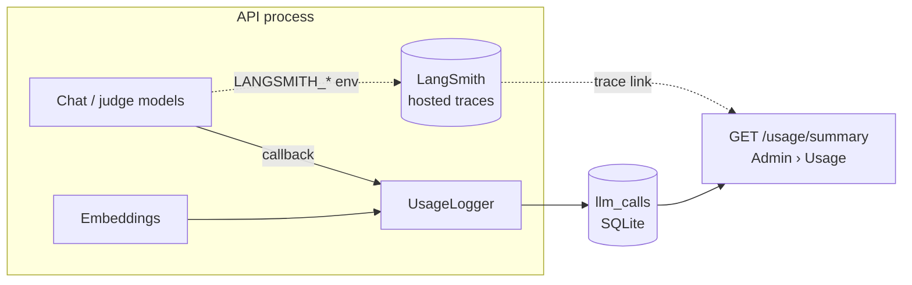

- **LangSmith tracing (optional):** `observability.configure_tracing` copies the `LANGSMITH_*`
  values from `.env` into the process environment (pydantic-settings doesn't), before the first
  model exists (langsmith caches them). The API is traced; CLI commands only with
  `rag --trace-langsmith`, so batch evaluations don't use up the free monthly trace allowance.
  `LANGSMITH_SAMPLING_RATE` traces a share of requests.
- **Usage log (always on):** `UsageLogger`, a LangChain callback on every chat model, writes one
  row per call (model, purpose, tokens, latency, error, run id); embeddings are logged by
  `RateLimitedEmbeddings`. Purpose comes from run metadata (`answer`, `rewrite`), from
  LangGraph's node name (`agent: grade`) or the model's default (`judge`). Logging failures are
  swallowed. Cost only for models priced in `model_prices.json` (no real prices hard-coded).
  The run id is LangSmith's run id, so Admin › Usage links each call to its trace.
- **Application log (plan D1):** `rag serve` passes `LOG_CONFIG` to uvicorn: JSON lines on
  stdout (`JsonFormatter`), our loggers and uvicorn at INFO, other libraries at WARNING (HTTP
  clients log request URLs). A middleware gives each request an id (the caller's `X-Request-ID`
  if it matches `[A-Za-z0-9-]{8,64}`, else a new one; returned in the response) and logs
  method, path (no query), status, ms and which credential kind was sent. A `ContextVar` holds
  the id and a log-record factory stamps it on every record, so the model-call lines
  (`_record`, the same facts as `llm_calls` incl. the LangSmith run id) and the `answer` line
  (route, answerable, abstain reason, citation and passage counts) of one request share it.
  Provider errors log their type and mapped status. Privacy: no question/answer text, no key
  values. Health probes are logged only when they fail. The CLI keeps its plain output (a
  NullHandler on `rag_platform`).
- **Docker Compose:** API image (python:3.12-slim + uv, dependencies in a cached layer) and UI
  image (Node build stage → nginx serving the static files, SPA fallback). nginx also forwards
  `/api/*` to the API container, and the production UI calls `/api` by default: same origin, so
  no CORS, and a local `rag serve` on port 8000 can't intercept the requests. nginx replaces any
  client-sent `X-Forwarded-For` with the browser's real IP, and the API trusts that header only
  from the nginx container's fixed address (`FORWARDED_ALLOW_IPS`), so the guest rate limit
  counts per user and can't be dodged with a fake IP. Index, uploads and
  `rag_config.json` are bind-mounted; secrets come from `.env` via `env_file`, never the image.
- **Health checks (plan D2):** `/health` = liveness (the process runs); `/ready` = readiness
  (config loads, SQLite answers, the FAISS index loads into the search cache; a missing model key
  already fails at startup with 503). No model call, so the 30-second Docker healthcheck costs no
  quota. Compose marks the API `healthy`/`unhealthy` (Python's urllib, the slim image has no
  curl), starts the UI only after the API is healthy, and checks nginx with busybox `wget`.
- **Security basics (plan B3-B6, B12):** both containers run as normal users (API uid 10001,
  nginx-unprivileged on 8080) with `no-new-privileges` and no Linux capabilities; the code in
  the image is read-only for the app. API port 8000 is published on 127.0.0.1 only. nginx sends
  security headers (Content-Security-Policy, nosniff, no framing, referrer and permissions
  policy) and hides its version; Angular's critical-CSS inlining is off because its inline
  script would break the strict `script-src 'self'`. Prompt-injection rule: every prompt that
  shows passages says they are untrusted data, never instructions (`UNTRUSTED_PASSAGES`);
  uploads with instruction-like text are flagged for the admin (section 7, B6).
  Dependabot proposes weekly updates (uv, npm, Actions, Docker); CI audits dependencies.
- **CI (GitHub Actions):** five parallel jobs — ruff + pytest; the quality gate; Vitest +
  production build; dependency audit (`pip-audit` on uv.lock, `npm audit`; two reviewed
  advisories without a fix ignored); Docker image builds. No secrets needed.

```mermaid
flowchart LR
    S[(embedding_snapshot.db<br/>128 vectors, in git)] --> G[rag gate:<br/>temp index of the sample corpus<br/>+ retrieval-only eval]
    C[rag_config.json] --> G
    G --> R{Recall@5 ≥ 0.85 · MRR ≥ 0.70<br/>no drop > 0.02 vs baseline?}
    R -->|yes| P[pass]
    R -->|no| F[fail the build]
    G -->|new texts, no key| W[skip with a warning]
```

The gate only checks deterministic retrieval metrics: answer metrics need LLM judge calls,
which CI should not spend on every push. `rag gate --export` refreshes the snapshot after a
change that alters the indexed texts; `--update-baseline` records accepted new numbers.

---

## 11. Key design decisions

| Decision | Reason |
|---|---|
| SQLite as source of truth, FAISS rebuildable | One reliable store; the index can never be "lost" |
| Incremental indexing + embedding cache | Re-indexing costs only what changed |
| Citations validated in code, abstention at 3 points | Never trust model output blindly; prefer "I don't know" to a wrong answer |
| Partial answers allowed, abstain only when no requested fact is in the passages | Broad questions get a useful, cited answer that says what is missing, instead of a refusal |
| One `question → answer` interface for both modes | Same evaluation and future API for fast and agentic |
| Evidence spans instead of chunk ids | Metrics stay comparable across chunking settings |
| RAGAS for answer quality, plain code for retrieval/abstention | Standard LLM-judge metrics + exact, free metrics for CI and the optimizer |
| Loop limits and budgets in code | An agent must always terminate and stay within cost |
| Rate limits for chat and embedding calls (chat: token bucket with a burst of 2) | Stay within Gemini's free-tier limits; a question's rewrite + answer go out without waiting (burst 1 added ~8.6 s per question) |
| Settings in `rag_config.json` (git) | Every change is visible and reviewable, like `appsettings.json` |
| Optimizer: code picks the winner, LLM explains | Same results always give the same choice; humans approve |
| Settings changed only via measured recommendations, never typed in | A change can't silently make answers worse; the human-approval step is visible in the UI |
| Quality checks in the UI are retrieval-only; full evaluations stay in the CLI | Seconds and no quota for the button; hundreds of judge calls stay a deliberate choice |
| Release gates in a JSON file, "n/a" when a run can't measure a metric | One source for UI and CI; a search-only run is never failed on answer metrics |
| Online evaluation: reference-free RAGAS metrics on a 1-in-5 sample, in the background | Quality of real usage without writing test data; bounded cost; no wait for users |
| No per-document test generation | Production practice: one curated test set for releases + monitoring of real usage; generated questions are easier than real ones. A human-reviewed draft helper is plan item C13 |
| Experiments are retrieval-only | Many experiments for almost no API cost |
| API: keys required, uploads validated by content, writes serialized | Safe by default; no half-written index |
| UI is a separate Angular app using only the REST API | One contract; front end and back end evolve and deploy independently |
| Memory by rewriting follow-ups, conversations in SQLite per guest id / key | Works for every pipeline mode; costs one call only for follow-ups; private per user |
| Topics and example questions in `assistant.json`, not in the UI | New users learn what to ask; another knowledge base only needs another file |
| Guests chat without registration; admins sign in with a key | Feels like a real chatbot; knowledge base and evaluation stay with operators; guest limit protects the quota |
| Developer details only in development builds | Production users see a clean chatbot |
| LangSmith for traces, a local SQLite log for usage | Deep debugging in a hosted tool; numbers that work offline and never depend on an account |
| API traced, CLI batch runs only on request | Stays inside the free plan's monthly trace allowance |
| CI gate on a committed embedding snapshot | Deterministic and free on every push: no API key, no quota, no flaky network |
| Docker Compose locally, no cloud yet | One-command start; the same images can move to any container platform later |
| Collections with one search index each (not one index + a filter) | Isolation by construction - the base for private per-user collections (phase 2); deleting a collection is deleting a file |

---

## 12. Open items and next steps

- **Pending (needs API quota):** full fast baseline with RAGAS and the fast-vs-agentic
  comparison. Retrieval-only baselines over all 50 questions are done: dense Recall@5 0.988 and
  MRR 0.850, hybrid 1.000 and 0.881. The data suggests a safe threshold of 0.68 instead of 0.35.
  To decide it in the UI: Admin › Settings › Run optimizer (or `uv run rag optimize --decision later`).
- **Possible next steps:** a separate `JUDGE_MODEL` (own rate limit and quota for scoring);
  Google/Microsoft sign-in instead of admin keys; a cloud deployment of the Docker images
  (e.g. Azure Container Apps); the CORS default could also allow `127.0.0.1:4200`.
