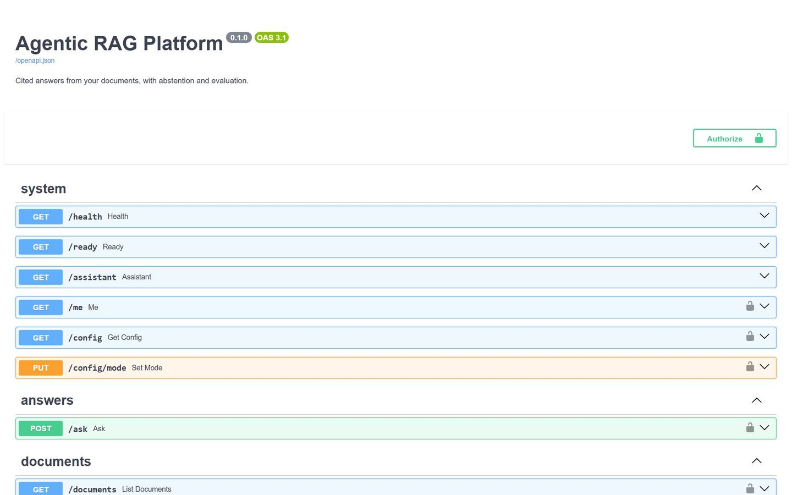
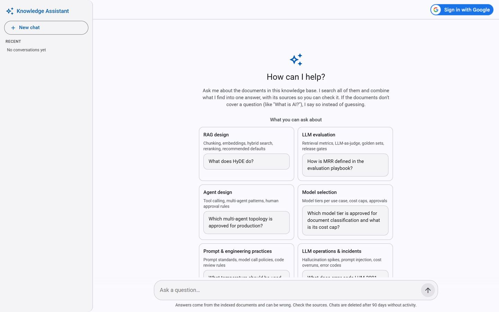
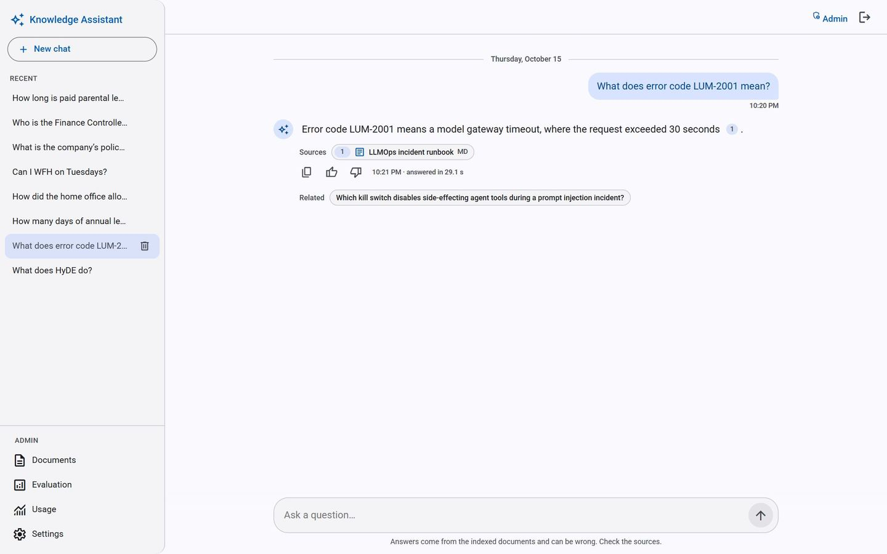
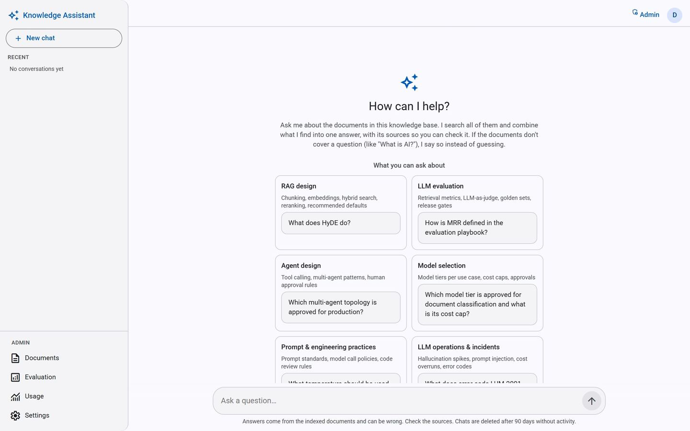

# Setup guide - run the Agentic RAG Platform on your machine

This guide takes you from an empty machine to a running app: a chat that answers questions from
documents with citations, plus the admin pages. No knowledge of the project is needed.
Commands are given for **Windows PowerShell** and for **macOS / Linux (bash)** where they differ.

**At the end you will have:**

| What | Address |
|---|---|
| Chat + admin web app | http://localhost:8080 (Docker) or http://localhost:4200 (local development) |
| REST API + interactive docs (Swagger) | http://127.0.0.1:8000/docs |
| Health / readiness checks | http://127.0.0.1:8000/health · http://127.0.0.1:8000/ready |

There are two ways to run it. Steps 1-5 are the same for both:

- **Option A - Docker** (recommended to *use* the app): one command starts API + web app.
- **Option B - local development** (to *change* the code): API and web app run in two terminals
  with live reload.

---

## Contents

1. [Install the tools](#1-install-the-tools)
2. [Get the code](#2-get-the-code)
3. [Get a Gemini API key](#3-get-a-gemini-api-key)
4. [Install the Python packages](#4-install-the-python-packages)
5. [Create the `.env` settings file](#5-create-the-env-settings-file)
6. [Check the key and index the sample documents](#6-check-the-key-and-index-the-sample-documents)
7. [Option A - run with Docker](#7-option-a---run-with-docker)
8. [Option B - run locally for development](#8-option-b---run-locally-for-development)
9. [First steps in the app](#9-first-steps-in-the-app)
10. [Optional: Sign in with Google](#10-optional-sign-in-with-google)
11. [Optional: LangSmith tracing](#11-optional-langsmith-tracing)
12. [Command-line tool (`rag`) cheat sheet](#12-command-line-tool-rag-cheat-sheet)
13. [Tests and quality checks](#13-tests-and-quality-checks)
14. [Where data is stored, and how to reset](#14-where-data-is-stored-and-how-to-reset)
15. [Troubleshooting](#15-troubleshooting)

---

## 1. Install the tools

| Tool | Needed for | Version | Get it |
|---|---|---|---|
| **Git** | getting the code | any | https://git-scm.com/downloads |
| **uv** | Python packages and the `rag` command (installs **Python 3.12** by itself) | 0.13 or newer | see below |
| **Docker Desktop** | Option A | recent | https://www.docker.com/products/docker-desktop/ |
| **Node.js** (includes npm) | Option B (the web app in development) | **24** | https://nodejs.org/ |

You do **not** need to install Python yourself: `uv` downloads the right version (3.12) on first
use. (.NET analogy: uv is like the `dotnet` CLI + NuGet in one tool.)

**Install uv**

Windows PowerShell:

```powershell
powershell -ExecutionPolicy ByPass -c "irm https://astral.sh/uv/install.ps1 | iex"
```

macOS / Linux:

```bash
curl -LsSf https://astral.sh/uv/install.sh | sh
```

Close and reopen the terminal, then check everything:

```powershell
git --version
uv --version
docker --version      # Option A
node --version        # Option B: should print v24.x
```

Expected output (your version numbers may be newer):

```text
git version 2.49.0.windows.1
uv 0.13.0 (4ecd0eff2 2026-10-09 x86_64-pc-windows-msvc)
Docker version 27.4.0, build bde2b89
v24.20.0
```

---

## 2. Get the code

```powershell
git clone https://github.com/ratheesh-5/agentic-rag-platform.git
cd agentic-rag-platform
```

All later commands are run **from this folder** (the project root) unless a step says otherwise.

> **Windows: use a short folder path**, e.g. `C:\projects\agentic-rag-platform`. Some Python
> package files sit deep inside `.venv`, and Windows refuses paths longer than 260 characters
> unless "long paths" are enabled. In a very deep folder the install looks fine but the first
> command fails with *"ImportError: ... No module named ..."* (seen while testing this guide).

---

## 3. Get a Gemini API key

The app uses Google **Gemini** for answers and for embeddings (turning text into vectors for
search). The free tier is enough to try everything.

1. Open https://aistudio.google.com/apikey and sign in with a Google account.
2. Click **Create API key** and copy it. Treat it like a password: never commit it or paste it
    into chats or tickets.

Free-tier limits (per model): about **15 chat requests per minute and 500 per day**, and **100
embedded texts per minute**. The app throttles itself to stay inside these limits.

---

## 4. Install the Python packages

```powershell
uv sync
```

Expected output (first run; takes about a minute when packages must be downloaded):

```text
Using CPython 3.12.15
Creating virtual environment at: .venv
Resolved 123 packages in 1ms
   Building rag-platform @ file:///C:/projects/agentic-rag-platform
      Built rag-platform @ file:///C:/projects/agentic-rag-platform
Prepared 1 package in 2.01s
Installed 122 packages in 4.32s
 + aiohappyeyeballs==2.7.1
 ... (one line per package)
```

This creates a virtual environment in `.venv/` (like a project-local package folder) with every
package from `uv.lock`, and installs the `rag` command. Run commands through uv, e.g.
`uv run rag --help` - no "activate" step needed.

---

## 5. Create the `.env` settings file

Settings and secrets live in a `.env` file in the project root. It is **git-ignored**; the
tracked template is `.env.example`.

Windows PowerShell:

```powershell
Copy-Item .env.example .env
```

macOS / Linux:

```bash
cp .env.example .env
```

Open `.env` in an editor and fill in the two required values:

```ini
GEMINI_API_KEY=your-gemini-key-from-step-3
API_KEYS=a-long-random-admin-key
```

`API_KEYS` are the **admin keys** for the web app's "Admin sign in" and for scripts (comma-
separated if you want several). Make a strong random one with:

```powershell
uv run python -c "import secrets; print(secrets.token_urlsafe(32))"
```

**Optional settings** (uncomment the line in `.env` to change a default):

| Setting | Default | What it does |
|---|---|---|
| `CHAT_MODEL` | `gemini-3.5-flash-lite` | Answer model. If it is overloaded (errors 503/504), try e.g. `gemini-3.1-flash-lite`: each model has its own quota |
| `EMBEDDING_MODEL` | `gemini-embedding-001` | **Don't change** unless you re-index every document |
| `GROQ_API_KEY` | empty | Optional second answer model ([Groq](https://console.groq.com), free key): takes over when Gemini is out of quota or overloaded; chosen in Admin › Settings › Answer model. Search keeps using Gemini |
| `GROQ_MODEL`, `GROQ_REQUESTS_PER_MINUTE` | `openai/gpt-oss-120b`, 5 | Groq model and client-side limit (free tier: ~8,000 tokens per minute) |
| `GUEST_QUESTIONS_PER_HOUR` | 20 | Questions per hour for visitors who don't sign in (per IP); 0 = guests off |
| `GOOGLE_CLIENT_ID`, `ADMIN_EMAILS` | empty | Sign in with Google - see [section 10](#10-optional-sign-in-with-google) |
| `USER_QUESTIONS_PER_HOUR` | 50 | Per signed-in Google user |
| `SESSION_DAYS` | 7 | How long a Google sign-in lasts |
| `USER_MAX_COLLECTIONS`, `USER_MAX_DOCUMENTS`, `USER_MAX_PASSAGES` | 5, 20, 500 | What one signed-in user may store in private collections |
| `CHAT_RETENTION_DAYS`, `USAGE_RETENTION_DAYS` | 90 | Chats without activity / usage-log rows older than this are deleted daily; 0 = keep |
| `ONLINE_EVAL_SAMPLE_RATE` | 0.2 | Share of chat answers scored in the background (1 in 5; uses extra AI calls); 0 = off |
| `MAX_UPLOAD_MB` | 10 | Largest document upload |
| `CORS_ORIGINS` | `http://localhost:4200` | Web apps on another address that may call the API (Option B) |
| `LANGSMITH_*` | off | Tracing - see [section 11](#11-optional-langsmith-tracing) |

Search settings (chunk size, number of passages, hybrid search, similarity threshold, answer
mode, answer model) are **not** in `.env`: they live in `rag_config.json` and are changed from the app
(Admin › Settings).

---

## 6. Check the key and index the sample documents

```powershell
uv run rag check
```

Makes one chat call per chat provider (Gemini, plus Groq if `GROQ_API_KEY` is set) and one
embedding call. Expected output (the chat model is your `CHAT_MODEL`):

```text
chat model (gemini): gemini-3.1-flash-lite -> 'OK'
chat model (groq): openai/gpt-oss-120b -> 'OK'
embedding model: gemini-embedding-001 -> 3072 dims
OK
```

If it fails, the message says why (wrong key, quota, model name).

Now index the six demo documents in `data/sample_corpus/` (a fictional company handbook, "Lumora
Labs"):

```powershell
uv run rag ingest
```

The first run embeds about 80 passages; it took **16 seconds** when this guide was tested (the
free tier allows 100 texts per minute, so a bigger corpus waits in between). Expected output:

```text
docs:   6 added, 0 updated, 0 unchanged, 0 deleted
chunks: 78 added, 0 removed
embeddings: 78 new, 0 from cache
store: 6 docs, 78 chunks  (data\index)
```

Later runs only embed new or changed text, so re-running it is quick and free (`0 new,
78 from cache`).

Try one question from the command line:

```powershell
uv run rag ask "What does error code LUM-2001 mean?"
```

Expected output - the answer with a citation and its source passage (character range and
similarity score):

```text
Error code LUM-2001 means that a model gateway timeout has occurred, specifically when a
request exceeds 30 seconds [2].

Sources:
  [2] data/sample_corpus/llmops_incident_runbook.md [1498:2290]  score 0.745
```

This is the whole RAG pipeline on the command line: search → answer → citation check. (The
wording of the answer can differ slightly from run to run.)

> Prefer not to install uv at all? With Docker only, skip this step and upload documents later
> in **Admin › Documents** in the web app.

---

## 7. Option A - run with Docker

Start Docker Desktop first and wait until it says it is running. Then, in the project root:

```powershell
docker compose up --build -d
```

- `--build` builds the two images (API and web app); the first build takes a few minutes.
- `-d` runs them in the background.

**If port 8080 is already used** by another program, choose another port:

Windows PowerShell:

```powershell
$env:UI_PORT = "8081"; docker compose up --build -d
```

macOS / Linux:

```bash
UI_PORT=8081 docker compose up --build -d
```

Then open **http://localhost:8080** (or your `UI_PORT`). The API docs are at
http://127.0.0.1:8000/docs (only reachable from your own machine).

Check that both containers are healthy:

```powershell
docker compose ps
```

Expected output (shortened; here with `UI_PORT=8081`) - both say `(healthy)` after about half a
minute:

```text
NAME                 SERVICE   STATUS                  PORTS
rag-platform-api-1   api       Up 12 hours (healthy)   127.0.0.1:8000->8000/tcp
rag-platform-ui-1    ui        Up 12 hours (healthy)   0.0.0.0:8081->8080/tcp
```

http://127.0.0.1:8000/ready shows the details (settings file, database, search index):

```text
{"status":"ready","checks":{"model_key":"ok","config":"ok","database":"ok",
 "search_index":"ok (94 passages)"}}
```

**Everyday Docker commands**

| Task | Command |
|---|---|
| Stop | `docker compose down` |
| Start again (no code change) | `docker compose up -d` |
| After pulling new code | `docker compose up --build -d` |
| After editing `.env` | `docker compose up -d --force-recreate api` |
| API log (JSON lines, one per request / AI call / answer) | `docker compose logs api --tail 20` |
| Follow the log live (Ctrl+C to stop) | `docker compose logs api -f` |

Remember the `UI_PORT` setting each time you run `up` in a new terminal if you use one.

**What the API log looks like** - one question, all lines tied together by the same
`request_id`: an embedding call for the search, the answer call, the outcome and the HTTP
request. The question text is never logged. (Lines shortened.)

```text
{"msg": "model call", "request_id": "28757c317070", "model": "gemini-embedding-001",
 "purpose": "embed", "texts": 1, "latency_ms": 696}
{"msg": "model call", "request_id": "28757c317070", "model": "gemini-3.1-flash-lite",
 "purpose": "answer", "input_tokens": 1133, "output_tokens": 94, "latency_ms": 1854}
{"msg": "answer", "request_id": "28757c317070", "route": "fast", "answerable": true,
 "citations": 1, "passages": 5}
{"msg": "request", "request_id": "28757c317070", "method": "POST", "path": "/chat",
 "auth": "guest-id", "status": 200, "ms": 3100}
```

Your documents, the index, chats and `rag_config.json` stay in the project folder
(`data/index/`, `data/uploads/`), so they survive restarts and rebuilds.

---

## 8. Option B - run locally for development

Use two terminals, both starting in the project root.

**Terminal 1 - the API** (restarts itself when you edit Python code):

```powershell
uv run rag serve --reload
```

API at http://127.0.0.1:8000, docs at http://127.0.0.1:8000/docs - every endpoint can be tried
there (**Authorize** takes an admin key):



**Terminal 2 - the web app:**

```powershell
cd ui
npm install          # first time only (and after package.json changes)
npm start
```

Open **http://localhost:4200** (use `localhost`, not `127.0.0.1`: the API allows the web app
only from the addresses in `CORS_ORIGINS`, and Google sign-in checks the address exactly). The
page reloads by itself when you edit the Angular code.

Stop either one with **Ctrl+C**.

---

## 9. First steps in the app

1. **Chat as a guest** - no sign-in needed. The welcome screen shows topics and example
    questions; click one, or ask e.g. *"What is the default chunk size?"*. Off-topic questions
    get *"I couldn't find this in the documents"* instead of a guess.

    

    Answers show numbered citations and source chips (click one to see the passage):

    

2. **Become admin** - click **Admin sign in** (top right) and paste one of your `API_KEYS`. If
    Google sign-in is configured, sign in with an email listed in `ADMIN_EMAILS` instead.
3. **Admin pages** (left sidebar, only for admins):

    

    - **Documents** - collections at the top (**New collection**, rename, delete); upload PDF,
      Word (.docx), Markdown or text files (drag and drop) into the selected collection; they can
     be asked about from the next question.
    - **Evaluation** - *Run quality check* measures search quality on the 50-question test set
     in about a second, with no AI calls; *Live quality* shows how real chat answers score.
    - **Usage** - AI calls, tokens, latency and errors.
    - **Settings** - the active configuration, the answer mode (Fast / Agentic / Auto), and
     *Find better settings* (the multi-agent optimizer; makes a few AI calls).

---

## 10. Optional: Sign in with Google

Lets people sign in with their Google account: their chats follow them to every device, and
admins are named people (by email) instead of a shared key. The setup is done **once by whoever
runs the app**; users only click the button. Nothing here needs a credit card.

1. **Project:** open https://console.cloud.google.com/projectcreate, give it a name (e.g.
    `knowledge-assistant`), keep **Location: No organization**, click **Create**, then select
    the project in the project picker at the top.
2. **Sign-in app:** open https://console.cloud.google.com/auth/overview → **Get started**:
    app name (e.g. *Knowledge Assistant*), support email, **Audience: External**, contact email,
    accept, **Create**.
3. **Test users:** https://console.cloud.google.com/auth/audience → **Test users → Add users**:
    the Google accounts allowed to sign in while the app is in testing (up to 100).
4. **Client ID:** https://console.cloud.google.com/auth/clients → **Create client** →
    **Web application**. Under **Authorized JavaScript origins** add:
    - `http://localhost`
    - `http://localhost:4200` (Option B)
    - `http://localhost:8080` and/or your `UI_PORT`, e.g. `http://localhost:8081` (Option A)

    Leave redirect URIs empty, click **Create** and copy the **Client ID** (ends with
    `.apps.googleusercontent.com`). Ignore the client secret - this app doesn't use one.

5. **`.env`:**

        GOOGLE_CLIENT_ID=1234567890-abc.apps.googleusercontent.com
        ADMIN_EMAILS=you@gmail.com

6. Restart the API (Docker: `docker compose up -d --force-recreate api`; Option B: stop and
    start `rag serve`), reload the page: the toolbar now shows **Sign in with Google**.

New Google clients can take a few minutes to start working. With an empty `GOOGLE_CLIENT_ID`
the app simply shows the "Admin sign in" (key) button instead.

---

## 11. Optional: LangSmith tracing

Shows every request as a tree of steps (prompts, tokens, timings) in the LangSmith web app.

1. Create a free account at https://smith.langchain.com and an API key (Settings → API Keys).
2. In `.env`:

        LANGSMITH_TRACING=true
        LANGSMITH_API_KEY=your-langsmith-key
        LANGSMITH_PROJECT=rag-platform

3. Restart the API. The API is traced automatically; command-line runs only with
    `uv run rag --trace-langsmith <command>` (so test runs don't use up the free monthly allowance).

---

## 12. Command-line tool (`rag`) cheat sheet

Run `uv run rag --help` or `uv run rag <command> --help` for every option.

| Command | What it does | AI calls |
|---|---|---|
| `uv run rag check` | Test the Gemini key | 2 |
| `uv run rag inspect` | Show how documents are split into passages | none |
| `uv run rag ingest [folder-or-file] [--collection NAME]` | Index documents (default `data/sample_corpus`, into the demo collection; a new NAME creates the collection); only new/changed text is embedded | embeddings for new text |
| `uv run rag delete <path>` | Remove a document from the index | none |
| `uv run rag ask "question"` | Answer one question; add `--collection NAME`, `--mode agentic`, `--trace`, `--show-context` | 1 (fast) / ~4 (agentic) |
| `uv run rag eval run --retrieval-only` | Search-quality metrics on the test set | none |
| `uv run rag eval run --limit 5` | Answers + RAGAS scores on 5 test questions | ~12 per question |
| `uv run rag eval list` / `eval compare 1 2` | List / compare evaluation runs | none |
| `uv run rag optimize` | Agents propose better settings; you approve or reject | a few |
| `uv run rag serve` | Start the REST API (`--reload` for development) | - |
| `uv run rag gate` | The CI quality gate, locally (no API key needed) | none |

---

## 13. Tests and quality checks

None of these call Gemini: the tests use fake models.

```powershell
uv run pytest                                  # backend tests
uv run ruff check .                            # Python lint
uv run ruff format --check .                   # Python formatting
uv run rag gate                                # retrieval quality gate (Recall@5, MRR)
```

Expected output of `pytest` (last line) and `rag gate`:

```text
193 passed in 58.89s
```

```text
  PASS  Recall@5             1.000 >= 0.85
  PASS  MRR                  0.881 >= 0.7
Quality gate passed.
```

Web app (in `ui/`):

```powershell
cd ui
npm test -- --watch=false                      # UI tests (Vitest)
npx prettier --check "src/**/*.{ts,html,scss}" # formatting
npm run build                                  # production build
```

GitHub Actions runs all of these (plus a dependency audit and the Docker builds) on every push;
see `.github/workflows/ci.yml`.

---

## 14. Where data is stored, and how to reset

| Path | Contents | In Git? |
|---|---|---|
| `.env` | Your keys and settings | **no** (secret) |
| `rag_config.json` | Active search settings and answer mode | yes |
| `assistant.json` | Topics and example questions shown in the chat | yes |
| `data/sample_corpus/` | The six demo documents | yes |
| `data/eval/` | Test set (`golden.jsonl`), release gates, CI snapshot | yes |
| `data/index/rag.db` | SQLite: documents, passages, embedding cache, chats, users, evaluation runs, usage log | no |
| `data/index/faiss.index` | Vector search index of the demo collection (rebuilt automatically from the database) | no |
| `data/index/collections/` | One vector search index per other collection | no |
| `data/uploads/` | Documents uploaded in the web app | no |

**Start over completely:** stop the app, delete the `data/index/` folder, then run
`uv run rag ingest` again. Note that this also deletes chats, users and evaluation history. (The
FAISS file alone can be deleted any time: it is rebuilt from the database without AI calls.)

---

## 15. Troubleshooting

| Problem | Cause and fix |
|---|---|
| `uv` or `node` "not recognized" after installing | Close and reopen the terminal (the PATH changed) |
| Right after installing, `rag ...` fails with *"ImportError ... No module named ..."* (Windows) | The project folder path is too long (260-character limit): clone into a short folder such as `C:\projects\` and run `uv sync` again |
| `rag check` fails with an auth/permission error | Wrong `GEMINI_API_KEY` in `.env`, or a space/quote around it |
| Answers fail with *"Model quota exceeded"* (HTTP 429) | Free-tier limit reached: wait a minute (or until the next day for the daily limit), set another `CHAT_MODEL`, or add `GROQ_API_KEY` so Groq takes over |
| *"The AI service is slow or overloaded"* (HTTP 503) | Google's model is busy: retry, or switch `CHAT_MODEL` (e.g. `gemini-3.1-flash-lite`) and restart the API |
| Every question says *"I couldn't find this"* | Nothing is indexed: run `uv run rag ingest` or upload documents; check `/ready` shows passages |
| Port 8080 already in use | Use `UI_PORT` (see [section 7](#7-option-a---run-with-docker)) |
| `UI_PORT=8081 docker compose ...` fails in PowerShell | That is bash syntax; use `$env:UI_PORT = "8081"; docker compose ...` |
| Docker: `env file .env not found` | Create `.env` first ([step 5](#5-create-the-env-settings-file)) |
| `docker compose ps` shows `unhealthy` | Open http://127.0.0.1:8000/ready - it names the failing check; see `docker compose logs api` |
| Docker Desktop won't start on Windows (*"removing stale socket ... userAnalyticsOtlpHttp.sock"*) | Quit Docker Desktop, rename the folder `%LOCALAPPDATA%\Docker\run`, start Docker Desktop again. Don't use "Reset to factory defaults" (it deletes all images and volumes) |
| Web app (Option B) shows *"can't be reached"* | The API isn't running: start `uv run rag serve` in terminal 1 |
| Browser error about CORS (Option B) | Open the app as `http://localhost:4200`, or add your address to `CORS_ORIGINS` |
| Google sign-in: *"origin not allowed"* / button missing | The page address must be listed exactly in the client's JavaScript origins (use `localhost`, not `127.0.0.1`); wait a few minutes after creating the client; the account must be a test user |
| `rag ingest` fails on a file starting with `~$` | A Word lock file (Word still has a document open): close Word or delete that file |
| Admin pages say *"Invalid or missing API key"* | The pasted key is not in `API_KEYS`, or the API wasn't restarted after editing `.env` |

---

More detail: [README.md](../README.md) (features, API endpoints) · [design.md](design.md)
(architecture and flow diagrams).
